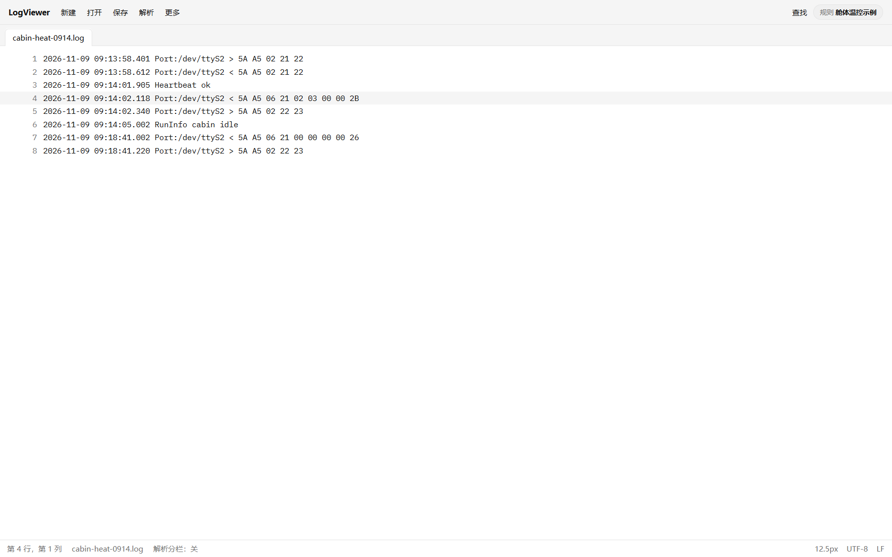
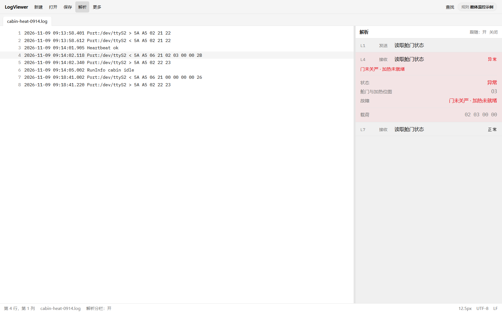
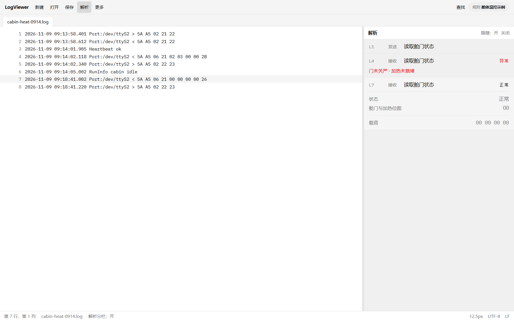

# 现场那一行十六进制，同事看不懂怎么办

**摘要：** 对着串口日志查故障时，最难的往往不是「有没有日志」，而是那一行十六进制发给同事之后，对方仍要翻协议文档。LogViewer 把同一行拆成一张能单独转发的解析卡片：中文标题、状态、人话说明，行号和十六进制还在。


---

早上九点，现场反馈舱体加热起不来。日志已经拉回来了，几千行，格式整齐，时间戳齐全。问题出在中间某一行：一串十六进制，方向是接收，字节挨着字节排好，却没有一句人话。

你认得时间，认得端口名，也大概猜得到这是「读状态」一类的应答。可真正要回答的是：这一帧在说什么？门关没关？加热有没有就绪？

于是打开协议 PDF，按偏移对字段，再对位图。对完一轮，心里有结论了，截一张图发给同事——对方看到的仍是同样的字节。电话里只能再说一遍：「第三个字节后面那两位，门相关；再后面是加热。」对方听懂了，却没法把这张图单独转给下一班。

这不是某一次疏忽。串口日志本来就是给机器和协议文档准备的：它忠实，但不替人说话。现场需要的，往往是一张能离开编辑器仍能看懂的说明。

## 一行十六进制长什么样

下面用虚构示例说明问题，不是任何在售设备的协议。

假设某次舱体温控模块的日志里有这样一行：

```
2026-11-09 09:14:02.118 Port:/dev/ttyS2 < 5A A5 06 21 02 03 00 00 2B
```

时间清楚，方向是接收，十六进制完整。发给没翻过协议的人，信息却停在「有一帧数据」这一层：标题是什么、正常还是异常、具体故障用中文怎么说，全都不在行里。



*图 1：解析未打开时，选中行仍是一串十六进制。（界面示意，虚构示例）*

同一命令在正常时可能长这样：

```
2026-11-09 09:18:41.002 Port:/dev/ttyS2 < 5A A5 06 21 00 00 00 00 26
```

两行看起来只差几个字节。对熟悉协议的人，差别一眼可见；对同事，两张截图几乎一样。

## 真正缺的是一张能单独转发的卡片

现场协作里，日志很少只给自己看。要截给售后、研发、下一班值班。如果截图里只有原文，每一次转发都在重复同一次翻译。

理想的画面是：左边仍是那一行日志，行号还在；右边是一张自足的卡片——命令用中文标题，状态写清楚，命中的故障用人话说出来，十六进制还留着，方便核对。别人不打开你的编辑器，也能读懂。点一下卡片，还能回到那一行，关系不用口头解释。

这正是 LogViewer 做的事。

## 打开解析分栏之后

LogViewer 是跨平台的日志阅读桌面应用。打开日志、多标签浏览、查找替换，这些和你熟悉的阅读器差不多。差别在「解析」这一侧。

导入对应设备的规则包，打开解析分栏，光标落到那一行时，右侧会出现解析结果。仍用上面的虚构示例：卡片标题是「读取舱门状态」，状态为「异常」，人话写着「门未关严；加热未就绪」。行号和载荷十六进制都还在。



*图 2：打开解析后，右侧卡片自足可读。（界面示意，虚构示例）*

正常那一帧对照时，标题仍是「读取舱门状态」，状态变为「正常」，故障相关的那一块直接不出现——不是藏起来，是没有可写的内容。同事拿到截图，不必再问「那些故障码去哪了」。



*图 3：同命令正常读数，故障块不出现。（界面示意，虚构示例）*

卡片是给「顺着日志查故障的人」和「只收到截图的人」同时准备的。前者要跳行、要对照原文；后者要自足、要中文。两边都不牺牲。

## 为什么不是再写一份摘要文档

有人会问：把结论写进工单不就行了？可以。但工单和日志会脱节。下一次再查同一段文件，又要重新对协议。摘要写在别处，原文在日志里，两份东西永远要对齐。

把翻译贴在那一行旁边，截图带走的是同一份事实：行号、判决、人话、十六进制。转发成本降下来，事后复查也不用猜「当时到底指的是哪一行」。

## 先解决「看不懂」这一步

现场最痛的往往不是缺工具，而是缺一层可读的呈现。LogViewer 不把协议写死进软件界面文案里，也不要求你每次手工标注；它用规则包认出这一行，再按规则译成卡片。

下一篇会顺着同一次打开日志的过程，把能力讲完整：从打开文件到右侧卡片，规则如何以加密包导入，以及为什么日志留在本机。

如需试用，请联系本文作者。

项目地址：https://github.com/chyi-dev/LogViewer
