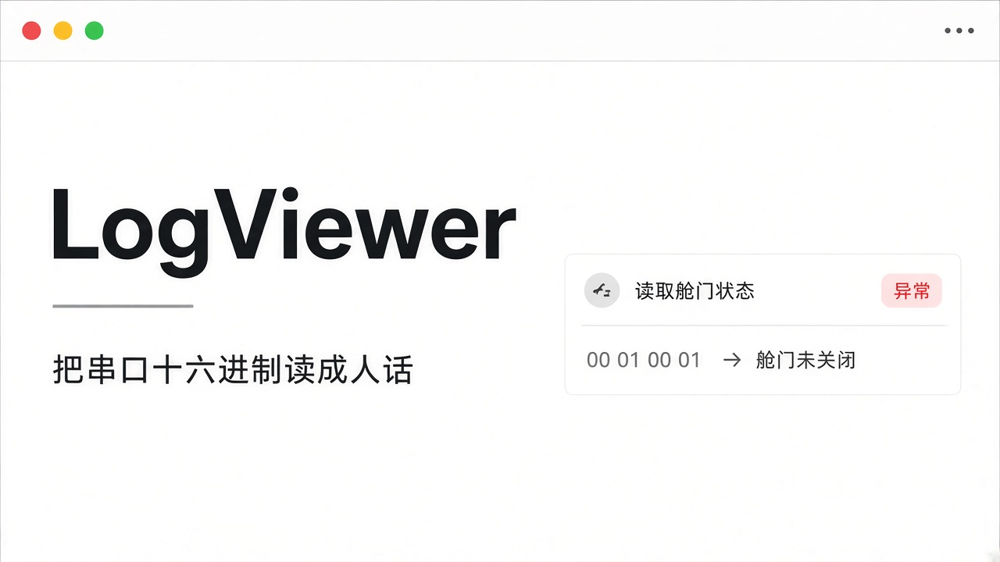
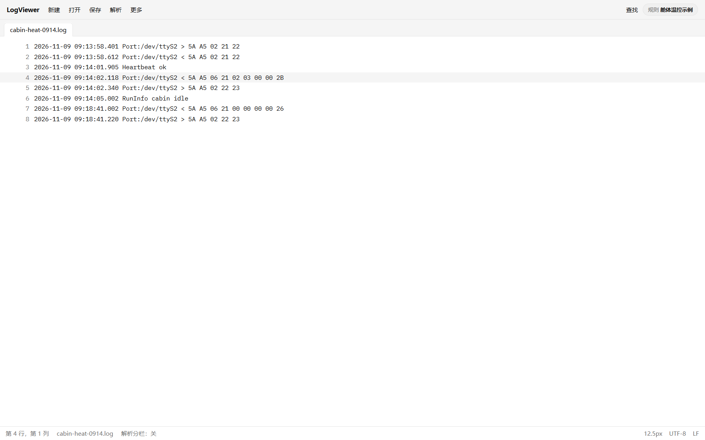
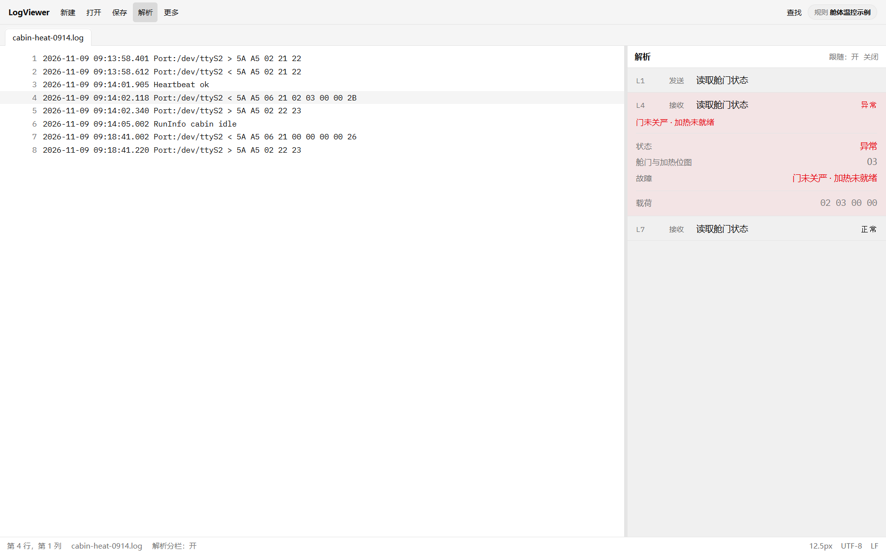
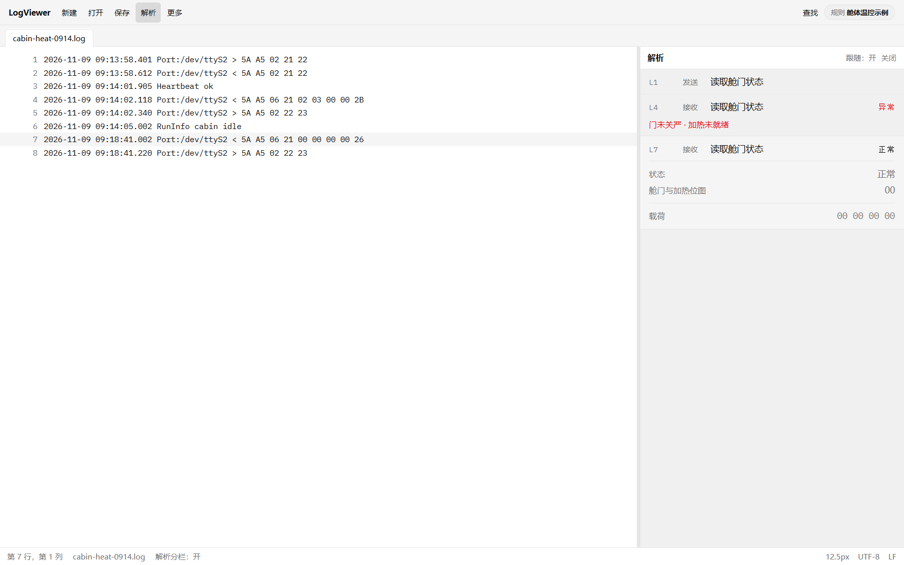
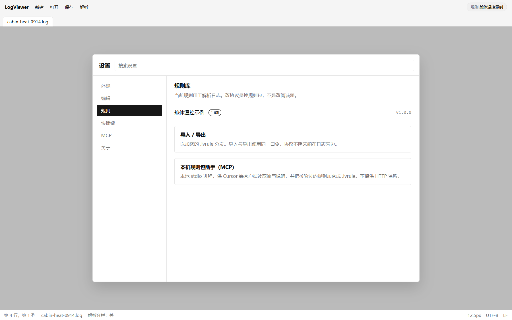

# 一张能单独看懂的卡片：打开日志之后发生了什么

**摘要：** 跟着同一次打开日志的过程看 LogViewer：多标签阅读、点到那一行、右侧解析卡片，以及加密规则包如何导入。桌面应用，日志留在本机；协议不明文躺在日志旁边。



---

上一篇讲的是现场那一行十六进制：截图发出去，同事仍要翻协议。这篇不再讲「为什么痛」，顺着同一次打开文件的过程，看 LogViewer 里实际发生了什么。

仍用虚构示例，不是任何在售设备的协议。假设日志里有舱体温控模块的两行：

```
2026-11-09 09:14:02.118 Port:/dev/ttyS2 < 5A A5 06 21 02 03 00 00 2B
```

以及稍后正常时的对照：

```
2026-11-09 09:18:41.002 Port:/dev/ttyS2 < 5A A5 06 21 00 00 00 00 26
```

## 打开文件，先把日志读起来

LogViewer 是桌面应用。文件在你本机打开，内容不经过远端「帮你解析一下」的中转。现场日志常带设备路径、时间戳、业务痕迹——留在本机，是默认姿态，不是事后补丁。

可以开多个标签，对照两份抓包、对照故障前后两段。查找、替换、转到某一行，都在熟悉的编辑体验里。这一步解决的是「把文件摊开」，还不是「把帧说成人话」。



*图 1：本机打开日志。（界面示意，虚构示例）*

## 点到那一行，右侧出现卡片

导入规则并打开解析分栏之后，把光标落到异常那一行。右侧不再是空白栏，而是一张解析卡片。

虚构示例里，卡片标题是「读取舱门状态」。状态写「异常」。人话是「门未关严；加热未就绪」。载荷的十六进制还在，行号还在。点卡片可以回到对应行——截给同事时，关系不用口头补一句「就是左边第多少行」。



*图 2：点到异常行，右侧出现可转发的卡片。（界面示意，虚构示例）*

再落到正常那一行：标题不变，状态变为「正常」，故障相关的块直接不出现。两张卡片并排（或先后截图），差别一眼可见，而不只是「中间几个字节不一样」。



*图 3：同命令正常读数，故障块不出现。（界面示意，虚构示例）*

卡片要自足：命令用中文，状态和字段名能单独读懂。它长在工作台右栏里，不是另开一张海报。你查故障时顺着日志走；要协作时，截的就是这一栏。

## 规则随文件走，却不明文躺在旁边

解析不是软件里写死的一版「通用串口魔法」。它依赖规则包：哪一种行格式里藏着方向和十六进制，哪一条命令译成什么标题，哪些位对应哪些人话。

规则可以导出、导入。落地形态是加密的 `.lvrule` 文件：用口令封好再分发，导入时用同一口令。协议细节不必以明文 JSON 贴在日志目录里，也不必每次用聊天窗口把规则原文贴来贴去。



*图 4：规则以加密包管理，助手留在本机。（界面示意，虚构示例）*

换设备、换协议版本，换的是规则包，不是重装阅读器。同一份日志，切到另一套规则，右侧卡片会按新规则重译——适合「这份文件到底该用哪套协议看」这种现场判断。

## 本机还有一个规则包助手入口

设置里有 MCP 相关项：本地 stdio 进程，给 Cursor 等客户端用，用来读取规则包编写说明，并把校验过的规则加密成 `.lvrule`。它不提供 HTTP 监听，不把你的日志或规则推到公网服务上。

现场同事通常只需要「导入已有规则 → 打开解析」；维护协议的人会用到加密导入，以及这个本机助手。下一篇专门写：协议为什么不必写进软件，规则包和助手如何配合。

## 这一次打开，带走的是什么

打开文件、点到行、看到卡片、把卡片截走——路径很短。短，是因为中间少了一层「再打开一份协议文档、再口头翻译一遍」。

LogViewer 把阅读和解析放在同一块桌面工作台里：左边是原文，右边是判决与人话。日志留在本机；规则以加密包流动；卡片可以离开屏幕，仍然说得清。

如需试用，请联系本文作者。

项目地址：https://github.com/chyi-dev/LogViewer
