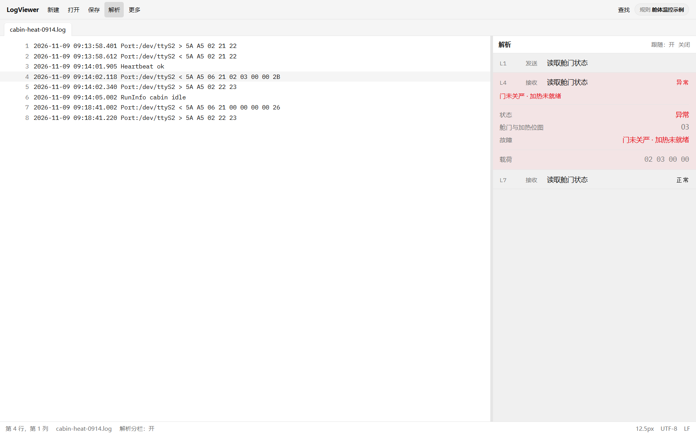
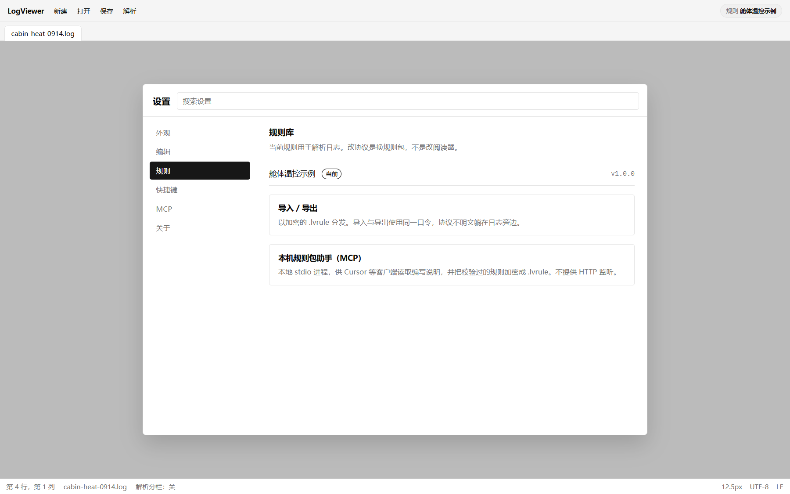
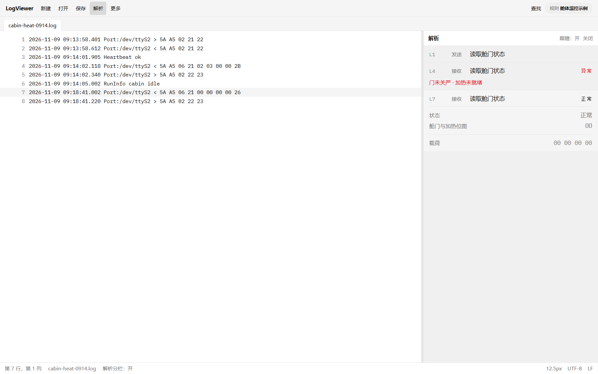

# 协议不必写进软件：规则包与本机助手

**摘要：** LogViewer 用规则包从日志行里认出方向与十六进制，再译成标题、状态和人话。协议变更是换加密的 `.lvrule`，不是改阅读器。本机助手按说明生成规则并加密，导入用同一口令。


---

前两篇站在「对着日志查故障的人」一侧：一行十六进制，一张能转发的卡片。这篇换成维护协议的人——你要回答的是：卡片从哪来？设备协议改了，软件要不要发一版？

结论先说：协议不必写进 LogViewer 的程序里。写进规则包即可。

## 规则包做两件事

仍用虚构示例，不是任何在售设备的协议。日志里可能出现：

```
2026-11-09 09:14:02.118 Port:/dev/ttyS2 < 5A A5 06 21 02 03 00 00 2B
```

规则包先教会软件：从这一整行里，哪一段是方向，哪一段是十六进制。认出行之后，再按命令译成卡片——例如标题「读取舱门状态」，状态「异常」，人话「门未关严；加热未就绪」。正常对照行则是状态「正常」，故障块不出现。



*图 1：规则把十六进制译成标题、状态与人话。（界面示意，虚构示例）*

也就是说，阅读器负责打开文件、分栏、跳行、展示卡片；「这一行是什么意思」交给规则。同一份日志换一套规则，右侧解释可以完全不同。这不是缺陷，是边界：协议知识跟设备走，跟规则包走，不跟安装包版本号绑死。

## 改协议，是换包，不是改软件

现场设备会升级。字段含义变了，故障文案改了，甚至行格式都变了。若这些都写死在应用程序里，每一次协议变更都要发版、装包、通知全员升级——成本落在所有只想「打开日志看一眼」的人身上。

规则包把变更收进一个文件。维护者更新规则，导出加密的 `.lvrule`，使用者导入，口令与导出时相同。阅读器还是原来的阅读器；解析结果已经按新协议说话。



*图 2：换的是规则包；导入导出走加密的 .lvrule。（界面示意，虚构示例）*

加密不是为了制造门槛，而是避免协议明文以可随意改的文本形式在聊天记录和共享盘里流转。需要改规则时，可以解密、编辑后再加密导入；日常分发则只传 `.lvrule`。

## 本机助手：说明在本地，文件也在本地

手写规则可行，但枯燥，也容易和文档不一致。LogViewer 在设置里提供规则包服务入口：本地 stdio 进程，供 Cursor 等客户端使用。它会提供编写说明，并在校验通过后，把规则包用口令写成 `.lvrule`。过程不监听网络端口，也不把规则写入应用规则库——生成文件在你指定的位置，导入仍由你在应用里完成。

工作方式可以概括成三步，不必展开成操作手册：

1. 客户端在本机连上这个助手，读到编写说明；
2. 按说明产出规则内容，再加密为 `.lvrule`；
3. 使用者在 LogViewer 里用同一口令导入，打开解析分栏查看效果。

助手帮的是「写出并封好规则包」；判断这一包该不该进现场、口令如何传递，仍是人的事。

## 和查故障的人如何分工

查故障的人：导入规则、打开日志、看卡片、截图转发。他们不必会写规则。

维护协议的人：保管规则包的演进，决定何时发新的 `.lvrule`，必要时用本机助手生成或更新。他们也不必为了改一句故障文案去动阅读器的发布流程。

中间那张卡片，是两边的交汇点：一边要读得快，一边要改得动。LogViewer 把交汇点放在规则包上，而不是放在下一次软件发版上。



*图 3：规则生效后的正常对照；无故障则可不出现故障块。（界面示意，虚构示例）*

## 系列收束

第一篇说现场那一行十六进制，同事看不懂；第二篇顺着打开日志的过程，看到卡片、加密导入和本机保留；这篇说明卡片背后的分工——协议在规则里，阅读器在本机，助手也在本机。

若你正在被串口日志和协议 PDF 来回拉扯，不妨从「先让一帧变成一张能转发的卡片」试起。

如需试用，请联系本文作者。

项目地址：https://github.com/chyi-dev/LogViewer
